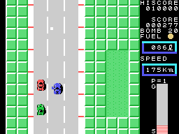
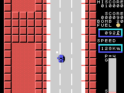

# The other cars

Up to ten other things share the road with the car: ten blocks of 32 bytes at 0xE360, each with
its kind in byte +4 (`coche_otro`, 0x95E2). Every so many frames one comes out, more often
the higher the zone (`salen_coches`, 0x9BE4).

## The cars

Kinds 1 and 2 are cars. Each one comes in from the top or from the bottom depending on its speed
and that of the player's car: its speed is the player's minus something at random
(`coche_otro_velocidad`, 0x966D). They bounce off the edges of the road (0x983B), and two cars
that touch push each other and swap speeds (`coches_se_empujan`, 0x9B63).

The cars of **kind 2** attack: when they are at the height of the player's car they move towards
its side (`coche_otro_persigue`, 0x97A3), and every 64 frames they change side (`coche_lado`,
0x9A4D). From zone 5, some of the fast cars turn into this kind too (`coche_otro_tipo`, 0x96C9).

Against the player's car: below 130 km/h they push each other, and the player's car is moved
aside and brakes (`empuja_der`, 0x9AD1); at 130 or more it is a crash.

**Three shots** on the same car destroy it, with a sound on each one (`coche_disparo`, 0x9A12);
**one bomb** is enough (`coche_bomba`, 0x99D2). A car destroyed gives 50 points; one of kind 2
gives 100 and **20 bombs** more (0x9A06).

## The truck

Kind 3 is the truck, four sprites long. It comes out every 240 frames from zone 3 onwards (from
zone 1 on the second lap), if the car is going at 80 km/h or more, and it changes side every so
often at random (`camion`, 0x9890). From zone 4, when the player's car is in its column, it
drops something behind it. **The shots bounce off it**, with their sound (0x98F2); it takes
**three bombs**: after two it blinks, and the third destroys it with **500 points** (0x9910).
Touching it is a crash (0x995B).

This GIF comes from a **forced** recording (`tools/guiones/zona4.tcl`): the first zone of the
game was changed from 1 to 4 as it was being set up, as the demonstration also does when it picks
a zone.

## The loose objects

- **Kind 4** comes down from the top on one side chosen at random, from zone 4 (from zone 1 on
  the second lap), once every 256 rows; if the car touches it, it **brakes 96 times**
  (`cosa4`, 0x94C4).
- **Kind 5** is what the truck drops: it blinks, a bomb that touches it explodes there, and the
  car that touches it crashes (`cosa5`, 0x946E).
