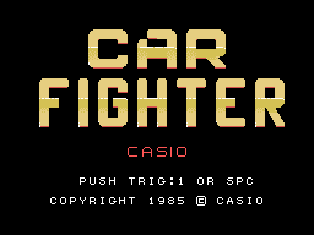
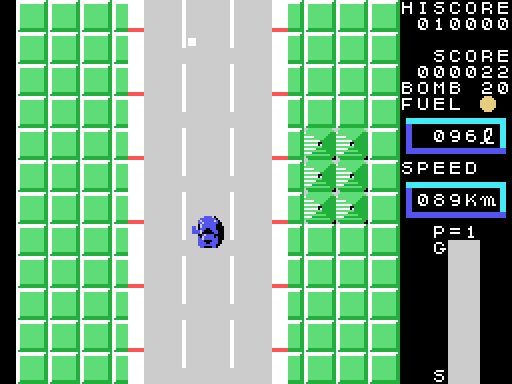
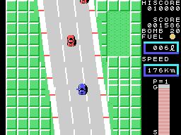

# The game

*Car Fighter* is a race across the United States, seen from above: the road scrolls down, the
car drives up it, and on the way there are other cars, a truck, fuel to watch and bombs to drop.
There are eight zones, each with its distance; at the end of each one, CHECK POINT, and at the end
of the eighth, GOAL. The zones are in [The zones](THE-ZONES.html), and the other cars in
[The other cars](THE-CARS.html).

Every GIF on this site is the ROM **running in openMSX** (a Japanese MSX1, at 60 frames per
second): on every frame the VRAM and the VDP registers are logged, and `tools/vdp.py` paints
them.

## The controls

| | joystick | keyboard |
|---|---|---|
| directions | joystick 1 | the cursor keys |
| button 1 | button A | the space bar |
| button 2 | button B | GRAPH |

The stick has eight directions (`coche_direccion`, 0x8A90):

- **up** accelerates, one step every two frames, and more slowly the faster it goes
  (`acelera`, 0x8BC6), up to **240 km/h**;
- **down** brakes, two steps per frame;
- **left and right** turn the car to that side and move it sideways, faster the faster it
  goes; the diagonals turn and accelerate or brake at the same time;
- with the stick let go, the speed drops little by little.

**Button 1** fires a shot in the direction the car is facing, 4 pixels per frame, until it
leaves the screen (`disparo`, 0x88E1). **Button 2** drops a **bomb**: one less on BOMB, it
leaves the same way at 2 pixels per frame and explodes 32 frames later (`bomba`, 0x8978). The
game starts with **20 bombs**.

## The scoreboard

On the right: HISCORE (the record, which starts at 10000), SCORE, BOMB, FUEL with its light and
the litres, SPEED in km/h, **P=** the zone, and a bar from **S** (start) to **G** (goal) that
fills as the zone goes by.

## The fuel

The tank holds **100 litres**. The car burns one litre every so many frames: the speed divided by
4, plus 14; standing still or slow, one every 60 (`gasolina_gasta`, 0x8843). Below 20 litres the
FUEL light blinks with its sound. At a **petrol station** by the road, one litre more every four
frames, up to 100 (`gasolinera`, 0x876E). With the tank empty the car stops: **EMPTY**, and
GAME OVER.

## Crashing

Below **130 km/h** (0x82 in the speed), the edges of the road and the other cars only push the
car. At 130 or more, touching them is a **crash** (`bordes`, 0x86B0; `coche_choca`, 0x9A65): the car
stops, its tune plays, it costs **ten litres** of fuel, and after a wait it is put back on the road
(`choque`, 0x8301). The crashes are in [The other cars](THE-CARS.html).

## The points

- **One point** for every row of road the car moves forward (`avance_punto`, 0x8CC0).
- A car destroyed, **50**; one of the cars that chase, **100** and **20 bombs** more; the truck,
  **500**.
- At the end of each zone, the fuel left goes down litre by litre: **100 points per litre**
  (`fin_zona_cuenta`, 0x846F).

The score stops at 999999.

## The demonstration

Without touching anything on the title, after 240 frames the computer plays a zone chosen at
random among the first four: every 48 frames it picks a direction at random, and it fires or
drops a bomb (`demostracion`, 0x90F6). Button 1 or the space bar go back to the title.
