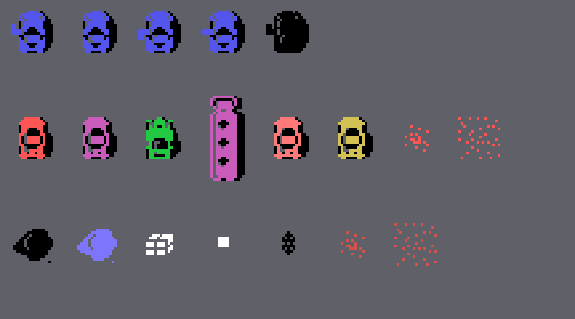

# The sprites

Everything on this page is **put together from the ROM's tables and code** with `tools/hojas.py`. None of these images
is a screenshot.

**Checked against openMSX** on the recordings of this site: the sprite drawing table (VRAM 0x3800-0x3FFF) is
**identical** to the 2 KB at 0xB800 on 49,805 frames (the other 5, while it loads). The other cars' sprites that the
game copies to the table follow the rules on this page on **41,057 car frames** (on 44, the second sprite's Y is still
behind, because it is copied before the move) and **1,786 truck frames** (one unexplained).

## The drawings

They are the 2 KB at 0xB800 that `sprites_dibujos` (0x8FD8) puts as they are at 0x3800; the real ones are the first
0x280 (the copy runs on through the tables, the code and the music to the end of the ROM). 16 x 16 sprites.

## The cars and the rest

At the top, the **car**: the drawing for where it faces (`coche_arriba` 0, `coche_derecha` 8, `coche_abajo` 0x0C,
`coche_izquierda` 0x10) in dark blue, with drawing 4 in black on top in all of them (0x81E1-0x81ED, `coche_y` 0x8B37);
after a crash, all black (0x8356).

In the middle, the **other cars**: 0x14 in red with 0x18 in black (`coche_otro_sale`, 0x963B); the attacking ones, in
magenta (0x96DD); those with 0x1C and 0x20, in green (0x96E7); the **truck**, four sprites (0x9605: 0x24 and 0x2C in
magenta with 0x28 and 0x30 in black; the rear pair 16 dots lower, `coche_sprites` 0x9574); a car **hit twice**, which
flashes light red and dark yellow every 4 frames (0x9A41; the truck, every 8, 0x98E2), and one **knocked out**, which
blows up in red with 0x34 and 0x38 (0x9B2B).

At the bottom, the **loose things** (`cosa4` 0x3C in black or light blue, `cosa5` 0x4C in white), the **shot** (0x40,
white), the **bomb** (0x44, black) and its **blast** (0x34 and 0x38, dark red).

The bomb's blast, frame by frame: 0x34 and 0x38 every 4 frames (`bomba_estallido`, 0x8A4B).

