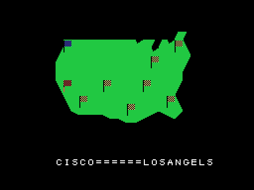
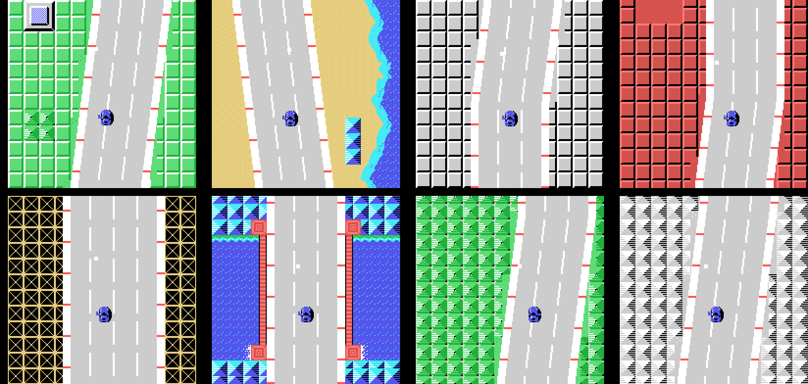
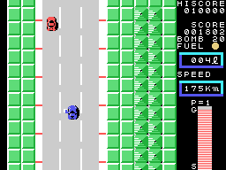
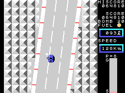

# The zones

## The map

Before each zone, a map of the United States in the middle of the screen (`mapa`, 0x8524): the
zones already done are marked with a line, the car blinks on the place of the zone, and below,
letter by letter and each with its sound, where the zone starts and where it ends
(`letra_a_letra`, 0x85F7). The map is stored compressed, in runs of tiles (0x9210).

The journey crosses the country from west to east. The names are written as the ROM has them
(0xB780):

| Zone | From | To |
|---:|---|---|
| 1 | CISCO | LOSANGELS |
| 2 | LOSANGELS | SANDIEGO |
| 3 | SANDIEGO | LASVEGAS |
| 4 | LASVEGAS | TEXAS |
| 5 | TEXAS | DARAS |
| 6 | DARAS | MIAMI |
| 7 | MIAMI | CHICAGO |
| 8 | CHICAGO | WASINGTON |

## The eight zones

Each zone has its own road: its pieces come from three lists per zone (0x9DAB, 0x9DBB and
0x9DCB), and two colours of its own (0x8010 and 0x8018); the second one paints the ground, tile 0x6D. In zone 2 the sea
is on the right, and its shore moves in 27 steps of five tiles (`fila_costa`, 0x8D13).

The length of each zone is in 0x8020, in units of 256 rows of road:

| Zone | 1 | 2 | 3 | 4 | 5 | 6 | 7 | 8 |
|---|---:|---:|---:|---:|---:|---:|---:|---:|
| rows | 1,536 | 1,536 | 1,768 | 2,048 | 2,048 | 2,304 | 2,560 | 1,536 |

Zone 3 needs 232 rows more than its table says: the main loop asks it for one more condition
(0x8248).

## CHECK POINT

When the distance is reached, the zone ends (`fin_zona`, 0x841C): its tune, **CHECK POINT**, the
car leaves through the top of the screen at 3 pixels per frame, and the fuel left is turned into
points, 100 per litre. Then the next zone, with the tank full again.

## GOAL

At the end of zone 8 the sign is **GOAL**. There is no ending: the game goes back to zone 1, one
lap more (`fin_zona_sig`, 0x84A6). On the second lap and after, the truck and the loose objects
come out from zone 1 (`salen_coches`, 0x9BE4).

This GIF and the map of zone 8 come from a **forced** recording (`tools/guiones/zonas.tcl`):
each zone was ended 450 frames after it started, by setting the end-of-zone flag (0xE184) as the
game does when the distance is reached.
