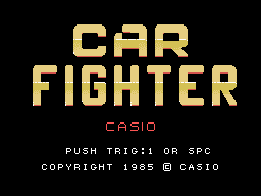
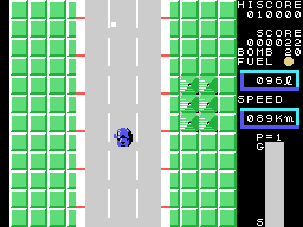
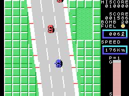

# La partida

*Car Fighter* es una carrera que cruza Estados Unidos, vista desde arriba: la carretera baja, el
coche sube por ella y por el camino hay otros coches, un camión, gasolina que vigilar y bombas que
tirar. Son ocho zonas, cada una con su distancia; al final de cada una, CHECK POINT, y al final
de la octava, GOAL. Las zonas están en [Las zonas](LAS-ZONAS.html), y los otros coches en
[Los otros coches](LOS-COCHES.html).

Todos los GIF de esta web son la ROM **funcionando en openMSX** (un MSX1 japonés, a 60 cuadros
por segundo): en cada cuadro se apuntan la VRAM y los registros del VDP, y `tools/vdp.py` los
pinta.

## Los mandos

| | mando | teclado |
|---|---|---|
| direcciones | el mando 1 | los cursores |
| botón 1 | el botón A | la barra espaciadora |
| botón 2 | el botón B | GRAPH |

La palanca tiene ocho direcciones (`coche_direccion`, 0x8A90):

- **arriba** acelera, un paso cada dos cuadros, y más despacio cuanto más corre (`acelera`,
  0x8BC6), hasta **240 km/h**;
- **abajo** frena, dos pasos por cuadro;
- **izquierda y derecha** giran el coche hacia ese lado y lo mueven de lado, más deprisa cuanto
  más corre; las diagonales giran y aceleran o frenan a la vez;
- con la palanca suelta, la velocidad baja poco a poco.

El **botón 1** dispara hacia donde mira el coche, 4 puntos por cuadro, hasta que el disparo sale
de la pantalla (`disparo`, 0x88E1). El **botón 2** tira una **bomba**: una menos en BOMB, sale
igual a 2 puntos por cuadro y estalla 32 cuadros después (`bomba`, 0x8978). La partida empieza
con **20 bombas**.

## El marcador

A la derecha: HISCORE (el récord, que empieza en 10000), SCORE, BOMB, FUEL con su luz y los
litros, SPEED en km/h, **P=** la zona, y una barra de **S** (la salida) a **G** (la meta) que se
llena según avanza la zona.

## La gasolina

El depósito tiene **100 litros**. El coche gasta un litro cada tantos cuadros: la velocidad
entre 4, más 14; parado o despacio, uno cada 60 (`gasolina_gasta`, 0x8843). Con menos de 20
litros la luz de FUEL parpadea con su sonido. En una **gasolinera** al lado de la carretera, un
litro más cada cuatro cuadros, hasta 100 (`gasolinera`, 0x876E). Con el depósito vacío el coche
se para: **EMPTY**, y GAME OVER.

## Los choques

Por debajo de **130 km/h** (0x82 en la velocidad), los bordes de la carretera y los otros coches
solo empujan al coche. A 130 o más, tocarlos es un **choque** (`bordes`, 0x86B0; `coche_choca`,
0x9A65): el coche se para, suena su música, cuesta **diez litros** de gasolina, y tras una espera
vuelve a la carretera (`choque`, 0x8301). Los choques están en [Los otros coches](LOS-COCHES.html).

## Los puntos

- **Un punto** por cada fila de carretera que avanza el coche (`avance_punto`, 0x8CC0).
- Un coche destrozado, **50**; uno de los que persiguen, **100** y **20 bombas** más; el camión,
  **500**.
- Al final de cada zona, la gasolina que queda baja de litro en litro: **100 puntos por litro**
  (`fin_zona_cuenta`, 0x846F).

Los puntos se quedan en 999999.

## La demostración

Sin tocar nada en el título, a los 240 cuadros el ordenador juega una zona elegida al azar entre
las cuatro primeras: cada 48 cuadros elige una dirección al azar, y dispara o tira una bomba
(`demostracion`, 0x90F6). El botón 1 o la barra vuelven al título.
