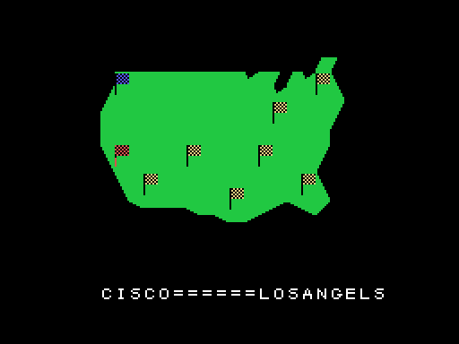
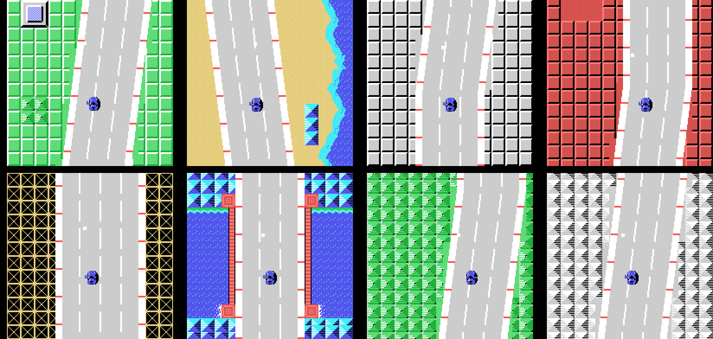
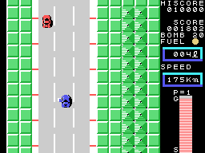
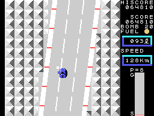

# Las zonas

## El mapa

Antes de cada zona, un mapa de Estados Unidos en el centro de la pantalla (`mapa`, 0x8524): las
zonas ya hechas, marcadas con una raya, el coche parpadea en el sitio de la zona, y debajo, letra
a letra y cada una con su sonido, dónde empieza la zona y dónde acaba (`letra_a_letra`, 0x85F7).
El mapa está guardado comprimido, en tramos de casillas (0x9210).

El viaje cruza el país de oeste a este. Los nombres van como los tiene la ROM (0xB780):

| Zona | Desde | Hasta |
|---:|---|---|
| 1 | CISCO | LOSANGELS |
| 2 | LOSANGELS | SANDIEGO |
| 3 | SANDIEGO | LASVEGAS |
| 4 | LASVEGAS | TEXAS |
| 5 | TEXAS | DARAS |
| 6 | DARAS | MIAMI |
| 7 | MIAMI | CHICAGO |
| 8 | CHICAGO | WASINGTON |

## Las ocho zonas

Cada zona tiene su carretera: sus trozos salen de tres listas por zona (0x9DAB, 0x9DBB y 0x9DCB),
y dos colores propios (0x8010 y 0x8018); el segundo pinta el suelo, la casilla 0x6D. En la zona 2
el mar está a la derecha, y su orilla se mueve en 27 pasos de cinco casillas (`fila_costa`,
0x8D13).

El largo de cada zona está en 0x8020, en unidades de 256 filas de carretera:

| Zona | 1 | 2 | 3 | 4 | 5 | 6 | 7 | 8 |
|---|---:|---:|---:|---:|---:|---:|---:|---:|
| filas | 1.536 | 1.536 | 1.768 | 2.048 | 2.048 | 2.304 | 2.560 | 1.536 |

La zona 3 pide 232 filas más de lo que dice su tabla: el bucle de la carrera le pone una
condición más (0x8248).

## CHECK POINT

Al llegar a la distancia, la zona se acaba (`fin_zona`, 0x841C): su música, **CHECK POINT**, el
coche sale por arriba de la pantalla a 3 puntos por cuadro, y la gasolina que queda se cambia por
puntos, 100 por litro. Después, la zona siguiente, con el depósito lleno otra vez.

## GOAL

Al final de la zona 8 el cartel es **GOAL**. No hay final: la partida vuelve a la zona 1, una
vuelta más (`fin_zona_sig`, 0x84A6). Desde la segunda vuelta, el camión y las cosas sueltas salen
desde la zona 1 (`salen_coches`, 0x9BE4).

Este GIF y el mapa de la zona 8 salen de una grabación **forzada** (`tools/guiones/zonas.tcl`):
cada zona se acabó 450 cuadros después de empezar, poniendo la marca del final de la zona
(0xE184) como la pone el juego al llegar a la distancia.
