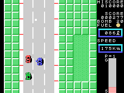
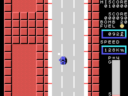

# Los otros coches

Hasta diez cosas más comparten la carretera con el coche: diez bloques de 32 bytes en 0xE360,
cada uno con su tipo en el byte +4 (`coche_otro`, 0x95E2). Cada tantos cuadros sale uno, más a
menudo cuanto más alta la zona (`salen_coches`, 0x9BE4).

## Los coches

Los tipos 1 y 2 son coches. Cada uno entra por arriba o por abajo según su velocidad y la del
coche del jugador: su velocidad es la del jugador menos algo al azar (`coche_otro_velocidad`,
0x966D). Rebotan en los bordes de la carretera (0x983B), y dos coches que se tocan se empujan y
se cambian la velocidad (`coches_se_empujan`, 0x9B63).

Los coches del **tipo 2** atacan: cuando están a la altura del coche del jugador se van hacia su
lado (`coche_otro_persigue`, 0x97A3), y cada 64 cuadros cambian de lado (`coche_lado`, 0x9A4D).
Desde la zona 5, algunos de los que corren mucho pasan a ser de este tipo (`coche_otro_tipo`,
0x96C9).

Si tocan al coche del jugador por debajo de 130 km/h, se empujan, y el coche del jugador se aparta
y frena (`empuja_der`, 0x9AD1); a 130 o más es un choque.

**Tres disparos** en el mismo coche lo destrozan, con un sonido en cada uno (`coche_disparo`,
0x9A12); basta **una bomba** (`coche_bomba`, 0x99D2). Un coche destrozado da 50 puntos; uno del
tipo 2, 100 y **20 bombas** más (0x9A06).

## El camión

El tipo 3 es el camión, de cuatro sprites de largo. Sale cada 240 cuadros desde la zona 3 (desde
la 1 en la segunda vuelta), si el coche va a 80 km/h o más, y cambia de lado cada tanto al azar
(`camion`, 0x9890). Desde la zona 4, cuando el coche del jugador está en su columna, suelta algo
por detrás. **Los disparos rebotan en él**, con su sonido (0x98F2); hacen falta **tres bombas**:
con dos parpadea, y la tercera lo destroza con **500 puntos** (0x9910). Tocarlo es un choque
(0x995B).

Este GIF sale de una grabación **forzada** (`tools/guiones/zona4.tcl`): la primera zona de la
partida se cambió de la 1 a la 4 mientras se montaba, como hace también la demostración al
elegir zona.

## Las cosas sueltas

- El **tipo 4** baja desde arriba por un lado elegido al azar, desde la zona 4 (desde la 1 en la
  segunda vuelta), una vez cada 256 filas; si el coche lo toca, **frena 96 veces** (`cosa4`,
  0x94C4).
- El **tipo 5** es lo que suelta el camión: parpadea, una bomba que lo toca estalla allí, y el
  coche que lo toca choca (`cosa5`, 0x946E).
