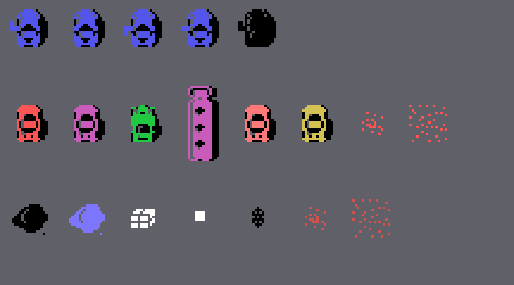

# Los sprites

Todo lo de esta p&aacute;gina est&aacute; **montado desde las tablas y el c&oacute;digo de la ROM** con
`tools/hojas.py`. Ninguna imagen es una captura.

**Cotejado con openMSX** en las grabaciones de la web: la tabla de dibujos de los sprites (VRAM 0x3800-0x3FFF) es
**id&eacute;ntica** a los 2 KB de 0xB800 en 49.805 cuadros (los 5 restantes, mientras se carga). Los sprites de los
otros coches que el juego copia a la tabla siguen las reglas de esta p&aacute;gina en **41.057 cuadros de coches** (en
44, la Y del segundo sprite va todav&iacute;a por detr&aacute;s, porque se copia antes de moverse) y **1.786 de
camiones** (uno sin explicar).

## Los dibujos

Son los 2 KB de 0xB800 que `sprites_dibujos` (0x8FD8) pone tal cual en 0x3800; los de verdad son los 0x280 primeros
(la copia sigue por las tablas, el c&oacute;digo y la m&uacute;sica hasta el final de la ROM). Sprites de 16 x 16.

## Los coches y lo dem&aacute;s

Arriba, el **coche**: el dibujo de hacia d&oacute;nde mira (`coche_arriba` el 0, `coche_derecha` el 8, `coche_abajo`
el 0x0C, `coche_izquierda` el 0x10) en azul oscuro, con el dibujo 4 en negro encima en todos (0x81E1-0x81ED,
`coche_y` 0x8B37); al chocar, negro entero (0x8356).

En medio, los **otros coches**: el 0x14 en rojo con el 0x18 en negro (`coche_otro_sale`, 0x963B); los que atacan, en
magenta (0x96DD); los del 0x1C y el 0x20, en verde (0x96E7); el **cami&oacute;n**, cuatro sprites (0x9605: el 0x24 y el
0x2C en magenta con el 0x28 y el 0x30 en negro; la pareja de detr&aacute;s, 16 puntos m&aacute;s abajo, `coche_sprites`
0x9574); un coche **tocado dos veces**, que parpadea en rojo claro y amarillo oscuro cada 4 cuadros (0x9A41; el
cami&oacute;n, cada 8, 0x98E2), y uno **derribado**, que estalla en rojo con el 0x34 y el 0x38 (0x9B2B).

Abajo, las **cosas sueltas** (`cosa4` el 0x3C en negro o azul claro, `cosa5` el 0x4C en blanco), el **disparo** (el
0x40, blanco), la **bomba** (el 0x44, negra) y su **estallido** (el 0x34 y el 0x38, rojo oscuro).

El estallido de la bomba, cuadro a cuadro: el 0x34 y el 0x38 cada 4 cuadros (`bomba_estallido`, 0x8A4B).

